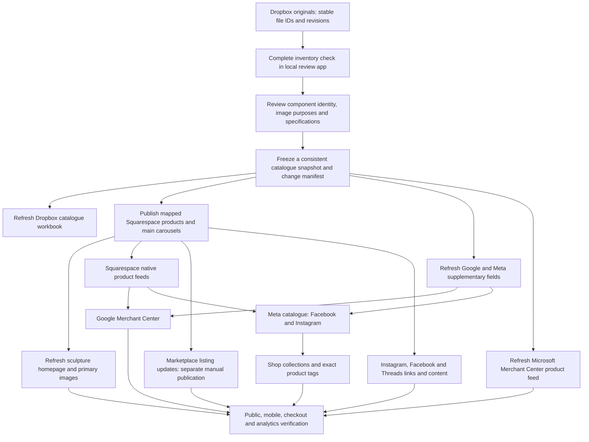

# Product update playbook

Use this directory for every change to a sculpture, its photographs, pricing or availability. The sculpture catalogue and saved review decisions are the central product record. Dropbox holds the original photographs. Squarespace and the shopping/social channels are published copies, not competing sources of truth.

Start with [the release checklist](release-checklist.md), then complete [the test matrix](test-matrix.md). Copy [the release record](release-record-template.md) for each update. [Channel links and identifiers](channels.md) locate the correct accounts. Evidence from the current setup work is under `evidence/2026-10-31/`.

[Mobile and owner-dependent steps](mobile-handoff.md) cover Instagram controls, purchase testing, the Customer Reviews agreement and the checkout returns inconsistency.

[Platform field requirements](platform-requirements.md) and the [reusable product-field template](templates/product-fields.json) cover complete product information, truthful missing fields, photographs, dispatch exceptions and notifications. The default dispatch allowance is now **10 working days**, with **three working days where required**. TikTok's shorter standard dispatch rule must be resolved before activating made-to-order stock.

[Microsoft Merchant Center](microsoft-merchant-center.md) records the correct Google account and daily import, the earlier manual feed now kept test-only, and the outstanding first-run verification. Meta Ads campaign import is separate from importing products.

[Google Sheets, Manufacturer Center and Pinterest](google-pinterest-catalogues.md) records the 7 November native master and retail feed, Dropbox backups, Pinterest approval barrier, GTIN requirement and verified Faire/Furnitures/Brandboom publication status. The Sheets snapshots need refreshing after app/website changes; Pinterest's saved schedule alone does not update a disabled source.

[Marketplace: the 30 additional listings and one blocked draft](marketplace-listings-2026-10-31.md).

[Setup status on 31 October 2026](status-2026-10-31.md) separates verified changes from platform review, missing evidence and owner-dependent work.

[Catalogue requirements and dispatch update on 1 November 2026](status-2026-11-01.md) records the current three/ten-day policy, corrected eBay/TikTok drafts, refreshed workbook and live channels, and remaining publication blockers.

## How an update should flow

## What happens automatically today

| Step | Current behaviour | Required action |
|---|---|---|
| Dropbox → review app | Inventory checks run while the local server is running; saved choices and identity rules still govern the result. | Wait for a successful complete check and review additions, merges, deletions and changed image bytes. |
| App edits → public website | Saving specifications, prices or image uses does not publish the website. | Capture and publish an explicit update. |
| Squarespace → main Google/Meta feeds | Native integrations refresh their feeds. | Verify the last processing time, exact variant IDs and changed fields. |
| Supplementary Google/Meta fields | Existing supplementary uploads are separate from the native feed. | Regenerate and refresh them after relevant changes; verify their precedence. |
| Microsoft Merchant Center | The 176-product feed was uploaded on 7 November. Free product listings and automatic price/availability checks are enabled; approval is pending. Full catalogue updates are manual. | Regenerate from the current app and verified website, update existing feed `1830841`, and reconcile the downloaded product report. Refresh before the feed expires; automatic item updates do not replace feed uploads. |
| Marketplace | Independent listings; no established automatic catalogue sync. | Update each existing listing by its saved listing ID; create only missing listings. |
| Posts, Stories, highlights and profile links | Existing content does not automatically adopt every product change. | Review affected content and links. Instagram web currently restricts bio-link editing to the mobile app. |

This directory documents the workflow; it does not install an unattended publisher. A successful import is not proof of public visibility, approval, correct checkout or an attributed purchase.

## Publication rules already agreed

- Keep the original catalogue name and a separate retail name. Use the retail name publicly.
- Keep stable component IDs, SKU and platform product/variant mappings through renames. Never identify a deletion or update by a mutable filename alone.
- Use the selected primary first, followed by all selected listing and in situ photographs in the main carousel. Deduplicate by identity/content. Advertising-only, excluded and unassigned images are not automatically published.
- A group photograph must be associated only with the components actually shown. It does not imply that a listing includes every photographed piece.
- Public copy describes the design, finish, outdoor suitability and usual keyhole fixings, with other options such as French cleats. **Owner update, 1 November 2026:** include a separate point, "Material: Made from a gypsum-based material." Where an applied finish is recorded, add a separate surface-effect point. This supersedes the earlier instruction to omit the underlying material. Do not describe these as solid bronze, copper, gold, marble or natural stone. Gold leaf defaults to imitation gold leaf. Keep detailed Royal Mail tiers out of product descriptions. See [the cross-platform material rule](product-copy-policy.md).
- Manufacturing cost excludes labour. Labour is separate and currently zero by default. Markup pricing uses manufacturing plus labour once; 100% markup doubles that total. Preserve any explicit fixed-price exception.
- Use packed shipping weight and package dimensions, not zero or the bare sculpture weight. Keep delivery policies and actual checkout charges consistent.
- Do not recreate products merely to refresh pictures. Preserve URLs and channel IDs; use redirects if an intentional URL change is unavoidable.
- Keep a receipt for each write and read back the exact result before retrying an uncertain operation.
- Apply the same current public copy to Squarespace, Google, Meta/Facebook/Instagram catalogues, Facebook Marketplace, eBay, TikTok Shop, Chairish, Wescover and Saatchi Art. Update an existing record by its recorded platform ID; only create a record after checking that the component and sale unit are absent on that account.

## Existing implementation references

- `catalogue-review/README.md`: current app behaviour, exports, syncing, image choices and jobs.
- `catalogue-review/dropbox_sync.py` and `dropbox_sync_worker.py`: inventory refresh.
- `catalogue-review/exports.py`, `specifications.py`, `costing.py`: catalogue exports and effective specifications/pricing.
- `outputs/website-marketplace-refresh-20261031/capture.py`: historical coherent snapshot example.
- `outputs/moonshell-lava-channel-refresh-20261031/prepare_channel_supplements.py`: historical platform supplement example.
- `outputs/moonshell-lava-channel-refresh-20261031/ecommerce-tracking.js`: existing consent-gated GA4 view/cart/checkout implementation.
- `outputs/marketplace-next30-20261031/publication-receipts.json`: additional Marketplace listing receipts.

The scripts under dated `outputs/` contain frozen paths, counts and snapshots. Review and parameterise them before reuse; do not blindly rerun a previous publication. Never commit credentials, customer/order data, the live review database or downloaded originals into Git.
