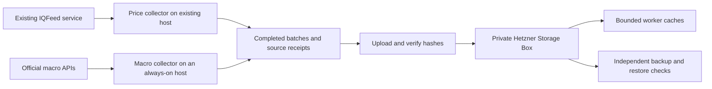

# Price and macroeconomic archive on Hetzner

Assessment date: 14 September 2026. This is a storage and update design, with a
fresh read-only Toshiba inventory. No Hetzner resource was purchased, no archive
was uploaded, and no collector or schedule was changed.

**Recommendation:** start with a private **BX21 5 TB Storage Box at EUR 10.90 per
month before VAT**, retain an independent backup, and upload immutable completed
acquisition batches. Keep IQFeed on its existing working host initially. Run
macroeconomic HTTP collectors on an existing always-on host or a small separate
Linux server. The Storage Box provides storage; it cannot execute collector
scripts. [BX21 specification](https://www.hetzner.com/storage/storage-box/bx21/),
[official price feed](https://website-price-api.hetzner.com/api/v1/products/ROBOT_1334),
[SSH service limits](https://docs.hetzner.com/storage/storage-box/access/access-ssh-rsync-borg/).

## Measured holdings

<!-- INVENTORY_START -->
The independently verified **run_06** scan ran from **2026-09-14T04:37:03.728291+00:00** to **2026-09-14T04:48:53.368014+00:00**.
It counted **949,203 files**, **21,921 directories** and **1,514,854,899,421 bytes (1.515 TB)** on the mounted 2 TB Toshiba. The configured volume UUID and storage identity matched.

| Non-overlapping primary archive | Files | Logical GB |
| --- | ---: | ---: |
| `marketmaker/iqfeed_archive` | 68,745 | 725.613 |
| `macroeconomics` | 11,265 | 13.031 |
| `marketmaker/macro_archive` | 540,550 | 41.828 |
| **Primary archive subtotal** | **620,560** | **780.471** |

The main IQFeed archive contains about 294.171 GB of equity tick files, 104.855 GB of futures tick files, 309.944 GB in its two main minute-bar families, and 0.192 GB in its two plain daily families. The remaining main-archive files are supplemental datasets and associated records.

The broader filename category `iqfeed_related` totals 731.497 GB; it overlaps the main archive and includes research/copy material, so it must not be added to that archive's size.

The separate broker trees `marketmaker/data/ibkr`, `marketmaker/data/ibkr_adr_home_fx_bbo_v1` and `marketmaker/data/ig` contain another 11.384 GB in total. They are outside the three primary roots but include varied source and derived files. No unique-raw-data total is asserted.

Within the newer macro archive, `macroeconomics/iqfeed` contains 6.803 GB, `incomplete` contains 6.109 GB of retained attempts, and `economic_releases` contains 19.064 MB. These are components of its 13.031 GB, not additions. The older macro tree also includes broader sources such as SEC and USAspending.

At scan completion the filesystem reported **1.973 TB used** and **26.885 GB free (25.04 GiB)**. Only about 5.04 GiB remains above the collectors' 20 GiB reserve.

Compared with run_05, the census has 17,540 newly observed paths, 377 metadata-changed paths, and 291 paths not seen this time. Logical bytes increased by 30.155 GB. The three primary archive roots have no file metadata differences in that comparison; this is not a payload-hash comparison. Most additional space is under `marketmaker/data/research`.

[Full inventory report](../../../../research/utility/toshiba_data_manifest_20260913_v1/run_06/REPORT.md), [independent verification](../../../../research/utility/toshiba_data_manifest_20260913_v1/run_06/VERIFICATION.json), [metadata comparison](../../../../research/utility/toshiba_data_manifest_20260913_v1/run_06/CHANGES_SUMMARY.json), [assessment facts](INVENTORY_FACTS.json).
<!-- INVENTORY_END -->

The census measures logical file lengths. It does not certify unique market
observations, continuous history, or payload integrity. Legacy CSV history,
repeated downloads, parsed representations, metadata and unsuccessful acquisition
evidence all occupy space. Provider-adjusted daily history remains adjusted even
when its response is preserved exactly. A cloud copy must preserve those source
identities rather than relabel every file as unadjusted exchange data.

The inventory includes inaccessible-directory records for `.Spotlight-V100` and
`.Trashes`, but cannot measure their interiors. It counts container files and
disk-image bands without inspecting embedded filesystems or database tables.
Physical filesystem use and logical file size are different quantities; the
difference is not a measured amount of removable data.

## Product choice and cost

Prices below were checked against Hetzner's public product price API. Exact
responses and their hashes are retained in [PRICE_RECEIPTS.json](PRICE_RECEIPTS.json).
Figures exclude VAT, collector compute, backups and any provider subscription.

| Option | Monthly storage cost | Appropriate use |
| --- | ---: | --- |
| BX21 Storage Box, 5 TB | EUR 10.90 | Primary file archive, with room for existing data and additions |
| Object Storage, up to 1 TB continuously held | EUR 6.49 | Small S3 archive or a selected collection for cloud readers |
| Object Storage, 1.5 TB continuously held | About EUR 9.62 | Entire current logical inventory is near this size |
| Object Storage, 2 TB continuously held | About EUR 12.75 | Automatic capacity growth with S3 access |
| Object Storage, 5 TB continuously held | About EUR 31.55 | Larger S3 archive when direct API access justifies the cost |

Object Storage examples assume a 30-day month, one continuously active account,
1 TB included, and EUR 0.0087 per additional TB-hour. Extra external egress is
EUR 1/TB after the hourly accumulated included allowance. Ingress and traffic
within Hetzner's `eu-central` network zone are free. Small objects have a 64 kB
minimum billable size, and versions also occupy storage. These are calculations,
not measured bills. [Object Storage pricing](https://www.hetzner.com/storage/object-storage/),
[billing rules](https://docs.hetzner.com/storage/object-storage/overview/).

An existing collector host adds no new Hetzner compute charge. For a new Linux
collector, budget separately: Hetzner's current notice lists CX23 at EUR 5.49 and
CPX22 at EUR 19.49/month before IPv4 and VAT. The public pages contain availability
restrictions; no orderable instance or account capacity was verified here. A
small collector is not intended to run large tick backtests.
[Current server price notice](https://docs.hetzner.com/general/infrastructure-and-availability/price-adjustment/),
[cost-optimized plans](https://www.hetzner.com/cloud/cost-optimized/).

The recommendation uses the Storage Box because the collection already contains
large ordinary files, repeated downloads and many small source records, and
growth to several TB is plausible. S3 is an alternative when many cloud workers
need direct object access. A bounded SSD cache on each worker should hold only
the inputs for that job. SQL/Parquet analysis should operate on verified derived
files; the original source responses remain separately retained. Neither network
storage product should become the live filesystem for SQLite queues, model
runtime state or memory-mapped backtest arrays.

The Box's snapshots consume the same storage quota. Reserve capacity for them;
twenty included snapshot slots do not mean twenty additional 5 TB copies.
[Snapshot storage accounting](https://docs.hetzner.com/storage/storage-box/general/#snapshots).

## Collection and publication



Use source-specific directories, for example:

```text
archive/
  imports/toshiba/<inventory-id>/<original-relative-path>
  raw/iqfeed/<cadence>/<instrument>/<request-id>/
  raw/fred/<series>/<capture-id>/
  raw/alfred/<series>/<vintage>/<capture-id>/
  raw/<other-provider>/<dataset>/<capture-id>/
  manifests/<batch-id>/
  derived/<transform-version>/<source-manifest-hash>/
```

For each batch retain the original response, request parameters with credentials
redacted, instrument/series identity, provider and underlying source, units,
adjustment convention, observation period, vendor timestamps and timezone,
release/vintage information actually supplied, local request/receipt times,
collector code hash, byte count, SHA-256, parse results and acquisition status.
Keep unavailable source clocks explicitly unknown. Research/model availability
clocks belong in derived-data records, not retroactively in historical sources.

Download to a bounded local spool on the collector. Use one durable queue and
writer per source; share the existing cooperative IQFeed download lock. Close and
hash a completed file, upload it to an incoming batch directory, verify its remote
content, then publish the batch manifest and completion marker last. Readers use
only published manifests. A failed upload does not advance the collection
watermark. Identical response bodies may share storage only through verified
content identity; all separate request receipts remain retained.

Transfer through SFTP or rsync over SSH. Hetzner's extended SSH/rsync endpoint is
port 23; start with two transfer connections and respect the Box's ten-connection
limit. Use credentials outside the repository and separate write/read access.
If S3 is chosen instead, use its actual regional HTTPS endpoint, immutable keys,
multipart uploads and an application-level SHA-256 manifest. Do not treat a
multipart ETag as a full-file checksum or assume a copy/delete operation is an
atomic rename. Hetzner's supported S3 operations differ from AWS's; the commit
protocol must not depend on unsupported notifications, replication or conditional
writes on versioned buckets.
[Storage Box access](https://docs.hetzner.com/storage/storage-box/access/access-ssh-rsync-borg/),
[S3 tool setup](https://docs.hetzner.com/storage/object-storage/getting-started/using-s3-api-tools/),
[supported S3 operations](https://docs.hetzner.com/storage/object-storage/supported-actions/).

## Regular updates

The following is a proposed operational cadence, not an already installed schedule.
Record a watermark per provider, instrument/series, cadence and adjustment mode.
Use exchange sessions and named timezones so DST and overnight futures sessions
do not silently alter the request window.

| Collection | Proposed schedule | Revision and gap handling |
| --- | --- | --- |
| Equity daily prices | After each completed session, with a later retry | Preserve the fetched response; periodically refresh full history and refresh affected symbols after corporate actions |
| Equity/futures minute bars | Nightly; more often for an explicitly selected live universe | Resume from verified coverage with 1–3 completed sessions of overlap; compare revisions and retain both captures |
| Historical ticks | Every completed session; hourly batches if live recording is required | Prioritize short-retention data; preserve ticks and correction/cancel messages and reconcile stream/history boundaries |
| IQFeed macro market instruments | After each instrument's completed session | Treat dated futures, vendor continuous contracts, cash rates and indices separately |
| FRED/ALFRED economic series | Daily; every 15–60 minutes around relevant scheduled releases | Detect changed series, enumerate new vintages, and fetch the full affected vintage including revisions to old periods |
| BLS/BEA, energy, central-bank and other official sources | According to each dataset's actual release cadence | Save each new response and metadata; do a periodic historical revision sweep |
| Archive operations | Upload completed batches promptly; verify status nightly | Weekly catalogue reconciliation and monthly representative restore checks |

IQFeed's API is a Windows executable/socket interface. The inspected machine has
IQConnect running under Wine, and its lookup socket at `127.0.0.1:9100` responded
to a TCP connection. Retaining this service is the smallest change. It still
requires that host to remain powered and connected. A fully remote installation
would need a supported Windows host, or a separately validated Wine deployment;
a plain Linux cron job cannot connect directly to IQFeed's upstream servers.
Use one licensed IQFeed service initially. Entitlements and permitted access on
any additional host must be checked before a cutover. The vendor advertises 180
calendar days of tick history, making unattended tick collection more urgent
than another full daily-price download.
[IQFeed developer interface and history](https://iqfeed.net/dev/index.cfm).

For economic statistics, use FRED/ALFRED for inflation, employment, rates and
financial-condition series, and direct BLS/BEA sources when appropriate. FRED's
`series/updates` covers only the preceding two weeks: after a longer outage,
reconcile the full subscribed-series registry. Use `series/vintagedates` and
`series/observations` with explicit vintage/real-time parameters. Today's revised
history is not what was available at an earlier trading decision; ALFRED's dates
also do not establish exact intraday publication or receipt times.
[FRED updates](https://fred.stlouisfed.org/docs/api/fred/series_updates.html),
[vintage discovery](https://fred.stlouisfed.org/docs/api/fred/series_vintagedates.html),
[observation API](https://fred.stlouisfed.org/docs/api/fred/series_observations.html),
[real-time periods](https://fred.stlouisfed.org/docs/api/fred/realtime_period.html).

EIA API v2 can supply energy statistics; use its API key, pagination and explicit
sorting. ECB's SDMX interface supplies European rates and other statistics with
metadata. Add CFTC, Treasury, ONS or other providers only for a defined dataset
registry and documented release semantics. Keep these separate from IQFeed
market-price proxies and from any paid consensus forecast data.
[EIA API](https://www.eia.gov/opendata/documentation.php),
[ECB API](https://data.ecb.europa.eu/help/api/overview),
[BLS API](https://www.bls.gov/developers/),
[BEA API](https://apps.bea.gov/API/signup/).

Scheduler jobs need persistent catch-up after a reboot, bounded retries with
provider rate-limit handling, disk-reserve checks, and a single-run lock. Monitor
last successful acquisition and publication separately, expected session/release
lag, pending gaps, entitlement failures, oldest unuploaded batch, free spool
space and verified restore results. A successful process exit alone is not proof
that a source is current. Retain negative and incomplete acquisition evidence.

## Repository work required before operation

| Existing component | Verified constraint | Required change |
| --- | --- | --- |
| `utils/iqfeed/macroeconomics/archive.py` | Durable queue and exact responses, but a sealed historical cutoff | Add a versioned incremental batch/queue mechanism; preserve the existing archive and cutoff |
| `utils/macroeconomics/archive.py` | Economic-release/vintage snapshots, not a recurring update service | Add subscribed-series discovery, new-vintage batches and long-outage reconciliation |
| `utils/iqfeed/daily_refresh.py` | Refreshes the selected 192-name panel and replaces its current parsed files | Preserve each raw fetch in the archive; keep current-view refresh separate from immutable history |
| `utils/data_paths.py` and `data_paths.json` | Bind local source paths to verified Toshiba identity | Add explicit remote archive locations and a verified cache resolver before any consumer cutover |
| `utils/external_storage/scripts/object_storage.py` | S3 client lacks an explicit custom endpoint; listing is a single page; multipart checksum is skipped; publish uses delete/copy | Do not use it for a large verified Hetzner migration as-is; use a scoped transfer implementation or repair these behaviours first |

The live IQFeed macro status says `FINISHED_WITH_RECORDED_SOURCE_LIMITATIONS`,
last observed data `2026-09-09 23:59:00`, with 99 denied and 22,267 no-data jobs.
Many no-data jobs were intentionally broad contract searches. The economic-release
snapshot also finished with source limitations, including blocked BLS documents
and unavailable consensus data. These statuses describe completed snapshot
requests, not a continuously updated archive. Rerunning `start` resumes pending
jobs and does not advance a sealed cutoff. A retained daily-refresh report ended
on 4 September; that single report does not establish the freshness of every
currently used daily file.

No configured Hetzner target was found in the inspected external-storage code,
SSH aliases or relevant environment-variable names. The dedicated `hetzner`
directory was empty before this assessment. This is not an authenticated audit
of the user's Hetzner account; resource availability, access credentials and
actual transfer throughput remain unverified.

## Initial migration and completion criteria

1. Select or provision the private destination and record its account/location
   identity. Check actual quota and access using a small write/read/hash/restore
   trial before starting the bulk copy.
2. Use the fresh census to select the source archive roots and all associated
   receipts. Inventory other price/provider and research-source trees explicitly.
   A conservative first copy can preserve the entire reachable inventory, so an
   uncertain classification does not lose a unique source. Do not deduplicate or
   delete by filename, symbol overlap or file size.
3. Copy stable files in resumable batches without a delete/mirror-delete option.
   Check mount identity before reading. For each file compare metadata before and
   after streaming its hash; defer files being written. Snapshot SQLite through
   its backup mechanism or quiesce its writer, and handle disk images consistently.
   Preserve relative paths, source metadata and failed/partial acquisitions.
4. Independently read and SHA-256 verify the destination payloads and reconcile
   every manifest entry. A transfer exit code or same-size listing is insufficient.
   Retain interrupted work and resume it; never publish an incomplete batch.
5. Install the incremental collectors and timers only after their storage and
   restart behaviour is validated. Test a missed session, a revised old value,
   a denied request, a collector restart and an interrupted upload. Verify a
   representative research input resolves to the expected source hash.
6. Retain the Toshiba copy through the initial restore checks. Freeing its space
   is a separate, explicitly scoped cleanup after verified copies and consumer
   mappings exist. Future increments also need an independent backup destination;
   Storage Box snapshots alone are not a second independent copy.

Hetzner exposes `sha256sum` through the restricted SSH service, so remote hash
verification can read the files on the Box without downloading the full archive
back to the Mac. Also perform actual restore-and-read checks for representative
files. The destination's hash result must match the saved source hash for the
exact stable acquisition; writing a client-supplied hash into metadata is not an
independent verification.
[Available SSH commands](https://docs.hetzner.com/storage/storage-box/access/access-ssh-rsync-borg/#available-commands).

At an assumed sustained **100 Mbit/s upload**, 780 GB takes about **17.3 hours**
and 1.5 TB about **33.3 hours**, before protocol, small-file and hash-verification
overheads. At 20 Mbit/s those times are five times longer. No upload speed test
was run. Stream batches directly; do not stage a terabyte-sized ZIP on the Mac
or nearly full Toshiba.

Five TB covers the current measured holdings, not unlimited future tick history.
Measure new compressed bytes per provider over 30 days, separately from research
outputs and migration copies, and size retention using that measured growth plus
backup/snapshot use and operating headroom. Alert before the destination or spool
runs short. The 20 GiB Toshiba collector reserve should remain enforced.
